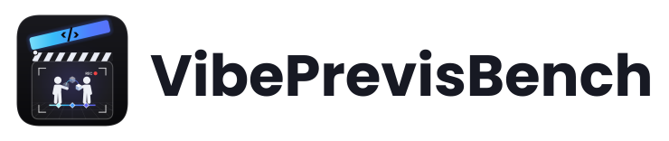
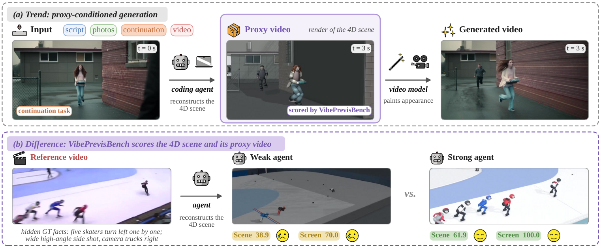
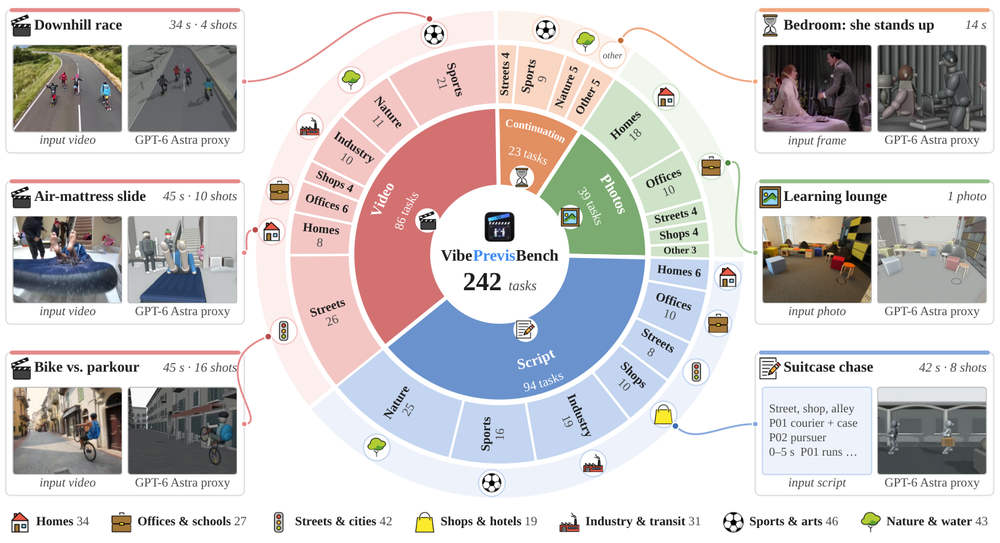
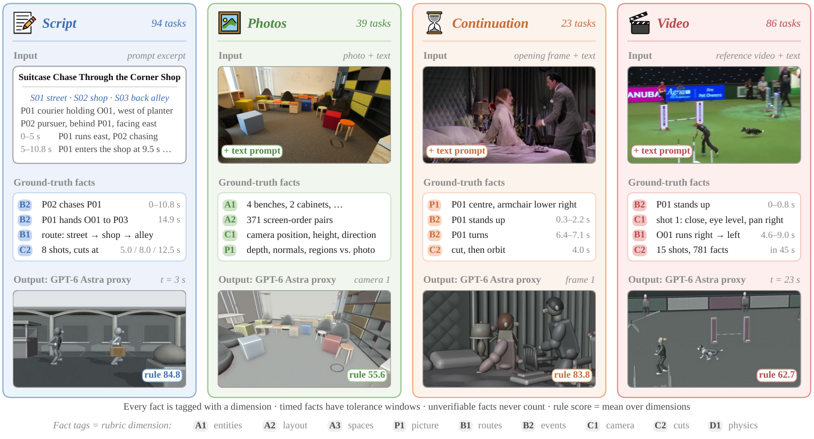
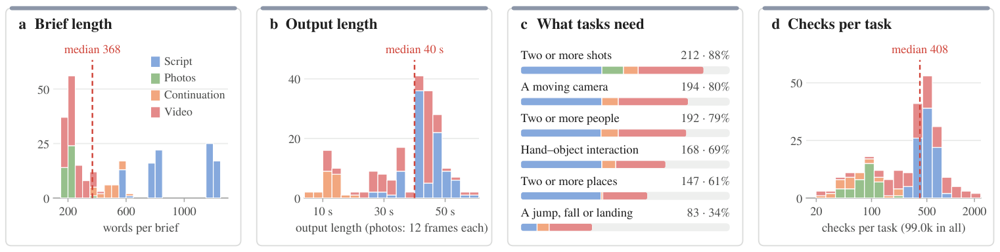
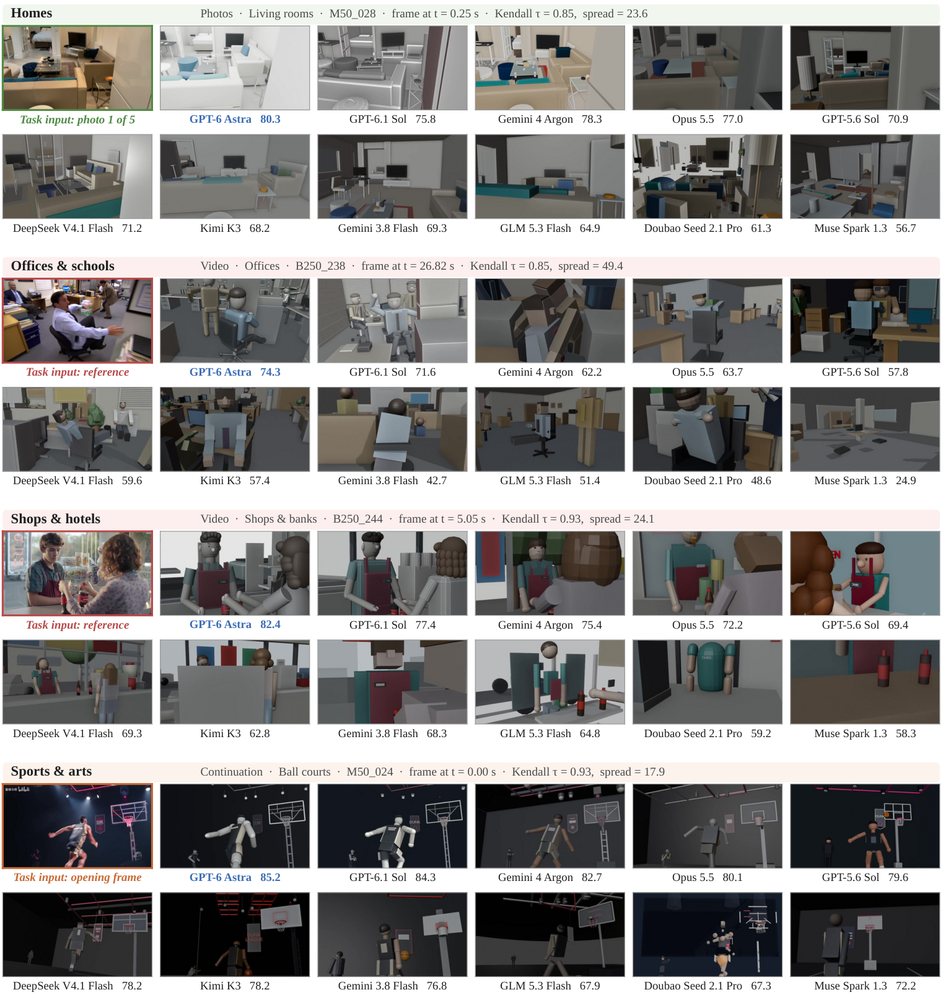
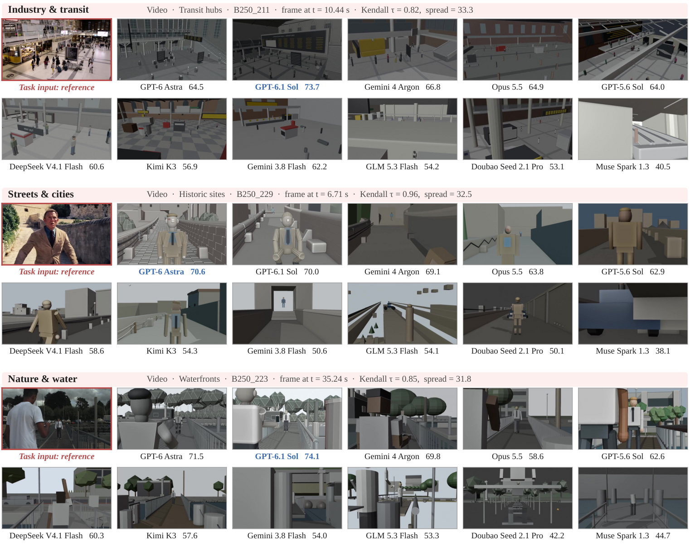

# VibePrevisBench: Evaluating Agentic Coding for 4D Scene Generation in Blender

<p align="center">
  <a href="https://vibeprevisbench.github.io/">
    <picture>
      <source media="(prefers-color-scheme: dark)" srcset="./assets/img/readme-brand-dark.svg">
      <source media="(prefers-color-scheme: light)" srcset="./assets/img/readme-brand-light.svg">
      
    </picture>
  </a>
</p>

<p align="center">
  <a href="https://vibeprevisbench.github.io/"></a>
  <a href="VibePrevisBench.pdf"></a>
  <a href="#-paper-and-citation"></a>
  <a href="https://huggingface.co/datasets/AidanYuzhe/vibeprevisbench"></a>
  <a href="#-evaluate-your-agent"></a>
</p>

## 💥 News

- **[2026.11.11]** 🚀 **Code and data are released.** The 242 tasks and their annotations are on
  [Hugging Face](https://huggingface.co/datasets/AidanYuzhe/vibeprevisbench), and this repository contains the
  complete evaluation pipeline. Start with [Evaluate your agent](#-evaluate-your-agent).
- 🌐 The [project homepage](https://vibeprevisbench.github.io/) is live, with benchmark results, an interactive
  leaderboard, and case studies.

## 👀 About VibePrevisBench

**Can a coding agent turn a brief into a 4D scene that a director can use?**

VibePrevisBench evaluates agentic coding for **4D scene generation in Blender**. Given a script, a few photos, an
opening frame to continue, or a reference video, an agent writes and runs Blender Python, renders previews, inspects
its frames, and delivers an executable greybox scene: who is where, when they move, how each shot is framed, and where
the cuts happen. The evaluator replays the delivered program and checks both the scene and what its proxy video shows.



- **242 tasks across four input kinds:** 94 scripts, 39 photo tasks, 23 continuations and 86 reference videos, in
  seven scene domains and 33 places.
- **84,406 scorable hidden GT facts** covering spatial layout, actions, cameras and physics.
- **Two scores:** Rule-based Scene Check compares the 4D scene with the hidden GT facts; VLM-based Screen Check tests
  whether what is right can be seen in the proxy video.
- **11 evaluated agents** and **14 interactive case studies** on the [project homepage](https://vibeprevisbench.github.io/).

## 📦 Dataset

Task briefs, annotations, rubrics and source manifests are on
[Hugging Face](https://huggingface.co/datasets/AidanYuzhe/vibeprevisbench). Third-party input images and videos are
not redistributed: `vpbench.py fetch-media` downloads them from their sources and rebuilds each file. The
[dataset layout](docs/dataset.md) describes every file, and [external inputs](docs/external-inputs.md) covers the
media sources.



*The 242 tasks span four input kinds (inner ring) and seven scene domains (outer ring). Each card is a real task
with its input and a frame of GPT-6 Astra's proxy video.*



*One task of each kind: what the agent receives, some of the hidden GT facts tagged with their rubric dimension,
and a frame of GPT-6 Astra's proxy video with its Rule-based Scene Check score.*



## 🚀 Evaluate your agent

An evaluation has four stages: get the data, run your agent on each task in its own sandbox, replay what it
delivered, and score the replay. Every stage is a `vpbench.py` command.

```text
download, fetch-media     data/: briefs, annotations and input media
        |
prepare, agent, collect   one Docker sandbox per task; the agent writes solution.py
        |
replay                    fresh sandbox: rerun solution.py and check the delivery
        |
score                     Rule-based Scene Check: scene vs hidden GT facts, no API
orbit, judge              VLM-based Screen Check: a VLM judges the proxy video
        |
report                    Scene and Screen over all 242 tasks
```

### 1. Install

Use Linux with Python 3.12 and Docker. The host also needs ffmpeg and ffprobe 5.1 or newer, and
[Blender 5.2.2](https://download.blender.org/release/Blender5.2/) for scene dumps and photo orbits.

```bash
git clone https://github.com/vibeprevisbench/vibeprevisbench.git
cd vibeprevisbench
python3.12 -m venv .venv && source .venv/bin/activate
pip install -r requirements.txt
# list missing tools
python vpbench.py doctor --blender /path/to/blender-5.2.2/blender
# sandbox image with Blender 5.2.2 and FFmpeg
docker build -t vibeprevisbench-sandbox:5.2.2 harness/docker
```

### 2. Get the data

```bash
# annotations, checked against SHA256SUMS
python vpbench.py download --repo AidanYuzhe/vibeprevisbench --data data --data-only
# the 215 input photos and videos, from their sources
python vpbench.py fetch-media --data data
# list files that are still missing
python vpbench.py fetch-media --data data --check
```

Some photos come from scan datasets that require an authorized copy; pass its root with `--datasets-root`.
`data/fetch_report.json` lists files that were reconstructed or are unavailable.

### 3. Run your agent on each task

`prepare` starts a fresh container for one task (8 CPUs and 16 GB, as in the paper) and stages the brief, the entity
and category tables and the input media. The agent reads `/opt/task/TASK.md`, works in `/work/blender_agent`, renders
and inspects with the managed `blender` command, and must leave a standalone program at `solution/solution.py`.
`collect` copies the solution and the workspace record to `runs/<system>/<ID>` and removes the container.

```bash
python vpbench.py prepare --data data --task B250_135 --run runs/my_agent
# start your agent in the container (Codex CLI, Claude Code, ...)
docker exec -it vpb-my_agent-b250_135 bash -l
python vpbench.py collect --task B250_135 --run runs/my_agent
```

To run all 242 tasks with the paper's 4-hour budget, set `AGENT_CMD` to the command that starts your agent on
`/opt/task/TASK.md`:

```bash
python - > task_ids.txt <<'EOF'
import json
for task in json.load(open("data/tasks/index.json"))["tasks"]:
    print(task["task_id"])
EOF
AGENT_CMD="YOUR_AGENT_COMMAND"
for id in $(cat task_ids.txt); do
  python vpbench.py prepare --data data --task "$id" --run runs/my_agent
  timeout 4h docker exec -w /work/blender_agent "vpb-my_agent-${id,,}" bash -lc "$AGENT_CMD"
  python vpbench.py collect --task "$id" --run runs/my_agent
done
```

The image contains no agent CLI or model credentials: install your agent in the container or drive it from outside.
To follow the paper protocol, give the agent no external assets and no network access other than its model API
(`--network` selects the Docker network), and never mount `data/rubrics/` in its container.

### 4. Replay the deliveries

```bash
python vpbench.py replay --data data --run runs/my_agent --jobs 4
```

Each `solution.py` runs again in a fresh container (4 CPUs, 8 GB, no network). The delivery must pass the paper's
three gates: the code runs standalone, the video renders in full, and the saved scene reopens. Replay writes
`scene.blend` and `video.mp4` to `runs/my_agent/<ID>/`; a task without a valid delivery scores zero. The default
`release` protocol uses the released photo briefs, which add an orbit; `--protocol paper` uses the paper's photo-only
briefs. Report which protocol you used.

### 5. Score

```bash
BLENDER=/path/to/blender-5.2.2/blender
RUN=runs/my_agent
OUT=results/my_agent
# Rule-based Scene Check: CPU only, no model API
python vpbench.py score --data data --run $RUN --blender "$BLENDER" --out $OUT/scene
# photo tasks: render the evaluator's orbit, which the judge watches
python vpbench.py orbit --data data --run $RUN --blender "$BLENDER"
# VLM-based Screen Check: an endpoint that speaks the Gemini generateContent API (paid calls);
# VPB_JUDGE_MODEL defaults to gemini-4-argon, the paper's judge
export VPB_JUDGE_API_KEY="YOUR_KEY"
python vpbench.py judge --data data --run $RUN --scores $OUT/scene --out $OUT/screen
# both scores over all 242 tasks
python vpbench.py report --data data --scores $OUT/scene --screen $OUT/screen \
  --out $OUT/report.json
```

| Output | Content |
| --- | --- |
| `results/my_agent/scene/scores.csv` | Scene score (0–100) and the nine dimensions of every task |
| `results/my_agent/scene/summary.json` | Scene columns of the leaderboard |
| `results/my_agent/scene/engine/` | Per-check reports; the judge reads them |
| `results/my_agent/screen/<ID>.json` | Judge verdicts and Screen score of each task |
| `results/my_agent/report.json` | Scene and Screen means over all 242 tasks; failed tasks count as zero |

The paper's Overall is the mean of the Scene and Screen means. For another judge provider, set `VPB_JUDGE_BASE_URL`
and, for bearer tokens, `VPB_JUDGE_AUTH=bearer`. `score` and `judge` keep finished tasks, so a stopped run can be
restarted. Compare per-task results with [`results/cells.csv`](results/cells.csv), and label results on a subset
(`--tasks`) as such. For local debugging without Docker, `prepare` and `replay` accept `--backend local`
([harness](docs/harness.md)).

## 📊 Evaluation protocol

**Rule-based Scene Check** (pvscore 5.4) exports the replayed 4D scene frame by frame and checks it against hidden
GT facts in nine dimensions: entities, layout, spaces, picture structure, routes, events, camera, cuts and physical
validity. It uses no model API. **VLM-based Screen Check** asks a judge to describe the proxy video blind, then to
judge identity, action, visibility and story checklists, asking only about facts the Scene Check found correct. The
paper uses Gemini 4 Argon. Both scores are on a 0–100 scale, Overall = ½ Scene + ½ Screen, and failed or missing
submissions count as zero in the 242-task average.

| Setting | Paper protocol |
| --- | --- |
| Scene engine | Blender 5.2.2 |
| Compute per run | 8 CPU cores, no GPU |
| Time budget | 4 hours per task |
| Isolation | Fresh sandbox; no external assets or network; no access to the scorer |
| Delivery checks | 21 automatic checks across three gates: code runs, video renders in full, scene reopens |
| Replay | The delivered program reruns in a fresh sandbox; the scene is exported frame by frame and the proxy rendered at 24 fps |
| Agent harness | GPT models in Codex CLI, all other models in Claude Code |

Photo tasks include an eight-second orbit in the released generation brief. The paper's agents received the original
photo-only brief; the evaluator added an orbit. The scorer remains pinned to `rubrics/<ID>/task.json` and reads the
photo frames only. See [evaluation details](docs/evaluation.md) and [reproducibility](docs/reproducibility.md) for
the checks behind the published numbers.

## 🏆 Published results

These are the frozen results of the paper (Table 1), not newly generated measurements. Rule-based Scene Check and
VLM-based Screen Check are given per input kind and over all 242 tasks (All). Screen Check uses the Gemini 4 Argon
judge, which rates only recognition on photo tasks. Overall, the mean of the two All columns, is placed next to the
effort so that it stays visible; the other columns follow Table 1. Failed runs score 0.
Per column, the best score is in bold and the second best is underlined.

<table>
<thead>
<tr><th rowspan="2" align="left">Agent</th><th rowspan="2">Effort</th><th rowspan="2">Overall</th><th colspan="5">Rule-based Scene Check</th><th colspan="5">VLM-based Screen Check</th></tr>
<tr><th>Script</th><th>Photo</th><th>Cont.</th><th>Video</th><th>All</th><th>Script</th><th>Photo</th><th>Cont.</th><th>Video</th><th>All</th></tr>
</thead>
<tbody>
<tr><td>GPT-6 Astra</td><td align="center">max</td><td align="right"><b>77.7</b></td><td align="right"><b>85.6</b></td><td align="right">55.8</td><td align="right"><b>79.8</b></td><td align="right"><b>56.8</b></td><td align="right"><b>70.0</b></td><td align="right"><b>76.5</b></td><td align="right"><ins>93.6</ins></td><td align="right"><b>91.1</b></td><td align="right"><b>89.8</b></td><td align="right"><b>85.4</b></td></tr>
<tr><td>GPT-6.1 Sol</td><td align="center">max</td><td align="right"><ins>76.1</ins></td><td align="right"><ins>84.4</ins></td><td align="right">55.3</td><td align="right">78.1</td><td align="right"><ins>56.0</ins></td><td align="right"><ins>69.0</ins></td><td align="right"><ins>73.3</ins></td><td align="right"><b>93.8</b></td><td align="right"><ins>89.5</ins></td><td align="right"><ins>87.3</ins></td><td align="right"><ins>83.1</ins></td></tr>
<tr><td>Gemini 4 Argon</td><td align="center">high</td><td align="right">75.0</td><td align="right">82.1</td><td align="right"><ins>57.1</ins></td><td align="right"><ins>78.5</ins></td><td align="right">55.8</td><td align="right">68.4</td><td align="right">72.7</td><td align="right">90.3</td><td align="right">88.8</td><td align="right">85.6</td><td align="right">81.7</td></tr>
<tr><td>Opus 5.5</td><td align="center">high</td><td align="right">74.1</td><td align="right">83.0</td><td align="right"><b>59.8</b></td><td align="right">78.2</td><td align="right">53.9</td><td align="right">68.4</td><td align="right">73.0</td><td align="right">90.4</td><td align="right">82.5</td><td align="right">81.6</td><td align="right">79.8</td></tr>
<tr><td>GPT-5.6 Sol</td><td align="center">max</td><td align="right">70.2</td><td align="right">80.8</td><td align="right">44.2</td><td align="right">73.0</td><td align="right">49.0</td><td align="right">62.9</td><td align="right">69.4</td><td align="right">92.5</td><td align="right">81.1</td><td align="right">78.7</td><td align="right">77.5</td></tr>
<tr><td>DeepSeek V4.1 Flash</td><td align="center">max</td><td align="right">69.6</td><td align="right">80.1</td><td align="right">43.2</td><td align="right">73.0</td><td align="right">45.7</td><td align="right">61.3</td><td align="right">70.8</td><td align="right">90.2</td><td align="right">82.4</td><td align="right">78.8</td><td align="right">77.9</td></tr>
<tr><td>Kimi K3</td><td align="center">xhigh</td><td align="right">67.5</td><td align="right">81.3</td><td align="right">42.4</td><td align="right">73.9</td><td align="right">45.2</td><td align="right">61.5</td><td align="right">69.3</td><td align="right">81.2</td><td align="right">80.9</td><td align="right">72.5</td><td align="right">73.5</td></tr>
<tr><td>Gemini 3.8 Flash</td><td align="center">high</td><td align="right">64.7</td><td align="right">78.6</td><td align="right">43.1</td><td align="right">71.4</td><td align="right">46.2</td><td align="right">60.7</td><td align="right">59.1</td><td align="right">87.7</td><td align="right">77.6</td><td align="right">68.3</td><td align="right">68.7</td></tr>
<tr><td>GLM 5.3 Flash</td><td align="center">high</td><td align="right">63.7</td><td align="right">76.0</td><td align="right">39.9</td><td align="right">71.0</td><td align="right">42.6</td><td align="right">57.8</td><td align="right">61.0</td><td align="right">84.8</td><td align="right">76.3</td><td align="right">70.2</td><td align="right">69.5</td></tr>
<tr><td>Doubao Seed 2.1 Pro</td><td align="center">max</td><td align="right">61.3</td><td align="right">73.6</td><td align="right">40.4</td><td align="right">65.7</td><td align="right">42.2</td><td align="right">56.3</td><td align="right">56.1</td><td align="right">86.8</td><td align="right">69.1</td><td align="right">67.2</td><td align="right">66.2</td></tr>
<tr><td>Muse Spark 1.3</td><td align="center">xhigh</td><td align="right">61.1</td><td align="right">77.4</td><td align="right">40.5</td><td align="right">67.2</td><td align="right">40.1</td><td align="right">57.2</td><td align="right">58.3</td><td align="right">84.7</td><td align="right">72.5</td><td align="right">61.3</td><td align="right">65.0</td></tr>
</tbody>
</table>

Per-task scores are in [`results/cells.csv`](results/cells.csv). [`results/leaderboard.csv`](results/leaderboard.csv)
and [`results/leaderboard.json`](results/leaderboard.json) give the aggregates to two decimals; their `rank` field
orders by the Scene score.

<details>
<summary>Evaluated models, agent harness and reasoning effort</summary>

| Model | Agent harness | Reasoning effort |
| --- | --- | --- |
| GPT-6 Astra | Codex CLI | max |
| GPT-6.1 Sol | Codex CLI | max |
| Gemini 4 Argon | Claude Code | high |
| Opus 5.5 | Claude Code | high |
| GPT-5.6 Sol | Codex CLI | max |
| DeepSeek V4.1 Flash | Claude Code | max |
| Kimi K3 | Claude Code | xhigh |
| Gemini 3.8 Flash | Claude Code | high |
| GLM 5.3 Flash | Claude Code | high |
| Doubao Seed 2.1 Pro | Claude Code | max |
| Muse Spark 1.3 | Claude Code | xhigh |

</details>

## 🎬 Examples





*One task per scene domain: the task input, then the frame at the same moment from each agent's proxy video, agents
in the order of the table above. Each frame carries the agent's overall score on that task, the best per task in bold.*

## 📁 Repository layout

```
vpbench.py          common command entry
scorer/             scene dump adapter and frozen pvscore engine
harness/            agent workspace, Docker sandbox, submission collection and replay
orbit/              deterministic evaluation-side photo orbit
judge/              two-turn VLM-based Screen Check
tools/              external media reconstruction
docs/               dataset, input sources, protocol and reproduction
results/            published leaderboard (JSON and CSV)
assets/             paper figures and the README logo
```

The dataset is downloaded into the ignored `data/` folder. Keep `rubrics/` and evaluation outputs outside the
agent's workspace.

## 📄 Paper and citation

*VibePrevisBench: Evaluating Agentic Coding for 4D Scene Generation in Blender*.

**[Read the latest paper (PDF)](VibePrevisBench.pdf).** Submitted to arXiv; the arXiv link will be added once the submission is publicly available.

Citation metadata is in [CITATION.cff](CITATION.cff); GitHub shows it under
"Cite this repository". The [project homepage](https://vibeprevisbench.github.io/) is published from the
[website repository](https://github.com/vibeprevisbench/vibeprevisbench.github.io).

## ⚖️ License, reference media and feedback

Code is released under [Apache-2.0](LICENSE). Dataset annotations are CC BY-NC-SA 4.0. Reference videos and images
remain the property of their original creators and are not redistributed; the dataset `NOTICE.md` lists their sources
and terms. Some reference videos show real people: use the benchmark for research on scene reconstruction only, not
to identify or profile the people shown. For corrections, questions or a rights-holder removal request, please
[open an issue](https://github.com/vibeprevisbench/vibeprevisbench/issues).
